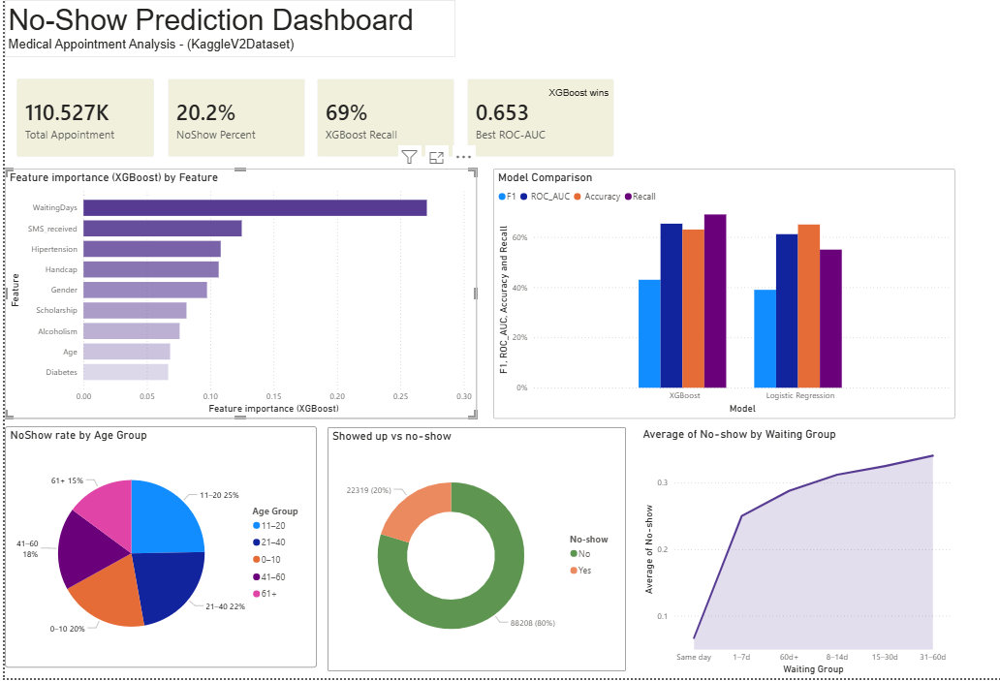
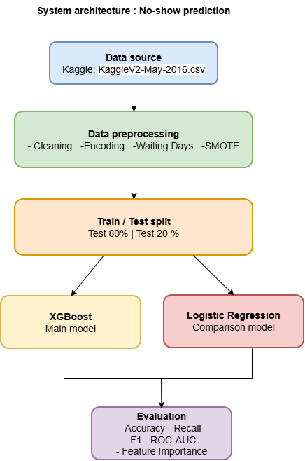
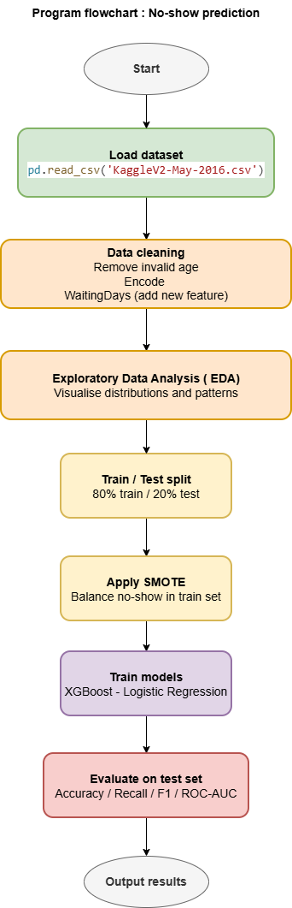

# Medical Appointment No-show Prediction

A Business Intelligence solution that predicts whether a patient will miss a scheduled medical appointment, using machine learning (XGBoost vs. Logistic Regression) and a Power BI dashboard for non-technical healthcare staff.

*Prepared by: Yejin Shin — Data Analytics, Assignment 2*

## Overview

Medical appointment no-shows waste clinical time, reduce revenue and lengthen waiting lists. Reported no-show rates average around 23% (Dantas et al., 2018). This project identifies patients at high risk of missing their appointment in advance, so that clinics can take proactive measures such as targeted reminders or strategic overbooking.

## Dataset

- **Source:** [Medical Appointment No Shows — Kaggle](https://www.kaggle.com/datasets/joniarroba/noshowappointments) (Arroba, 2016)
- **Size:** 110,527 appointment records from public health clinics in Vitória, Brazil
- **Features:** 14 variables — patient demographics, health conditions, scheduling details and SMS reminder status
- **Target:** `No-show` (1 = did not attend, 0 = attended)
- **Class balance:** ~80% attended / ~20% no-show (imbalanced)

## Approach

### Preprocessing
1. Removed an invalid record with `Age = -1`.
2. Capped `Handcap` (values up to 4) at 1 to keep it binary.
3. Encoded `Gender` (F = 0, M = 1) and `No-show` (No = 0, Yes = 1).
4. Converted `ScheduledDay` and `AppointmentDay` to datetime.
5. Engineered **`WaitingDays`** — days between booking and the appointment.

### Modelling
- **Train/test split:** 80% / 20%
- **SMOTE** applied to the training set only (no-show class 17,855 → 70,565; 141,130 balanced training rows). The test set keeps the real-world distribution to avoid data leakage.
- **XGBoost** — primary model (gradient-boosted trees, feature importance)
- **Logistic Regression** — baseline comparison model

Program flow

## Results

| Metric | XGBoost | Logistic Regression |
|---|---|---|
| Accuracy | 0.63 | **0.65** |
| Precision (no-show) | **0.31** | 0.30 |
| Recall (no-show) | **0.69** | 0.55 |
| F1-score | **0.43** | 0.39 |
| ROC-AUC | **0.65** | 0.61 |
| No-shows detected (of 4,464) | **3,101** | 2,433 |

Recall on the no-show class is the key metric. A missed no-show means lost clinical time with no chance to step in, which costs more than an unnecessary reminder. XGBoost detects **668 more no-shows** than Logistic Regression. Its lower precision (more false alarms) is an acceptable trade-off for a reminder system.

### Key insights
- **`WaitingDays` is the strongest predictor** (~27% of XGBoost's feature importance). The longer the wait, the higher the no-show rate.
- Patients who received an SMS had a *higher* no-show rate. This likely reflects selection bias: clinics already sent SMS reminders to patients they judged high-risk.
- Health conditions (hypertension, diabetes) carry relatively little predictive weight compared with scheduling and patient factors.

## Power BI Dashboard

`Assignment2_YEJINSHIN.pbix` is a single-page interactive report built from four CSV files exported by the Python pipeline. It contains:

- **Cards:** total appointments, overall no-show rate, XGBoost recall, best ROC-AUC
- **Charts:**
  - XGBoost feature importance
  - Attended vs. no-show split
  - XGBoost vs. Logistic Regression metrics
  - No-show rate by age group
  - No-show rate by waiting period

| Exported CSV | Contents |
|---|---|
| `predictions.csv` | Test-set predictions and predicted probabilities |
| `model_metrics.csv` | Performance metrics for both models |
| `feature_importance.csv` | XGBoost feature importance scores |
| `eda_data.csv` | Preprocessed dataset used for EDA |

## Tech Stack

- **Python** (Jupyter Notebook in VS Code)
  - pandas, NumPy — data loading and feature engineering
  - Matplotlib, Seaborn — EDA and visualisation
  - scikit-learn — splitting, Logistic Regression, metrics
  - XGBoost — primary classifier
  - imbalanced-learn — SMOTE
- **Microsoft Power BI Desktop** — dashboard / user interface

## Repository Contents

| File | Description |
|---|---|
| `Assignment2_YEJINSHIN.pbix` | Power BI dashboard |
| `Assignment2_YEJINSHIN_1576240.csv.code-workspace` | VS Code workspace file |
| `images/` | Figures from the technical report |

## Limitations & Future Work

**Limitations**
- Accuracy is modest (0.63–0.65), and low precision means many flagged patients actually attend.
- The data comes from Brazilian public clinics and may not generalise to other healthcare systems.
- Neither model was hyperparameter-tuned.

**Future work**
- Compare against Random Forest or deep learning classifiers.
- Tune XGBoost with cross-validated grid search.
- Add features such as appointment day-of-week and time.
- Connect the Power BI dashboard to real-time data so it becomes a live decision-support tool.
- Add SHAP explanations so clinical staff can see why each patient was flagged.

## References

- Arroba, J. (2016). *Medical appointment no shows* [Data set]. Kaggle.
- Bibi, M., et al. (2021). Medical appointment no-show prediction using machine learning. *ICIC 2021*, IEEE.
- Chawla, N. V., Bowyer, K. W., Hall, L. O., & Kegelmeyer, W. P. (2002). SMOTE: Synthetic minority over-sampling technique. *JAIR*, 16, 321–357.
- Chen, T., & Guestrin, C. (2016). XGBoost: A scalable tree boosting system. *KDD '16*, 785–794.
- Dantas, L. F., et al. (2018). No-shows in appointment scheduling: A systematic review. *Health Policy*, 122(4), 412–421.
- He, H., & Garcia, E. A. (2009). Learning from imbalanced data. *IEEE TKDE*, 21(9), 1263–1284.
- Hosmer, D. W., Lemeshow, S., & Sturdivant, R. X. (2013). *Applied logistic regression* (3rd ed.). Wiley.
- Islam, M. S., et al. (2022). A systematic review on healthcare analytics. *Healthcare*, 10(2), 348.
- Lundberg, S. M., & Lee, S.-I. (2017). A unified approach to interpreting model predictions. *NeurIPS 2017*.
- Rajkomar, A., Dean, J., & Kohane, I. (2019). Machine learning in medicine. *NEJM*, 380(14), 1347–1358.
